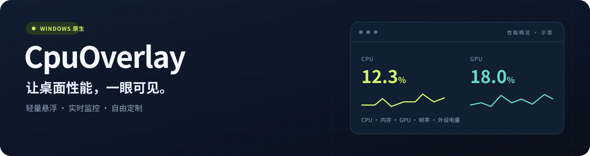
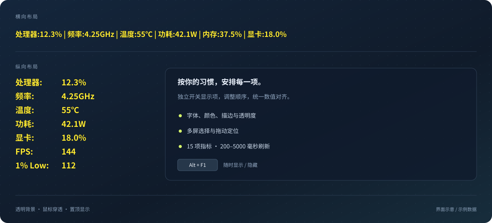

<div align="center">



# CpuOverlay

**轻量、直观、可定制的 Windows 桌面性能悬浮窗**

CPU · 内存 · GPU · 游戏帧率 · 键鼠电量 · Codex 余量 · 水冷温度数显

<p>
  <a href="https://github.com/sclliang/CpuOverlay/releases/latest"></a>
  
  
  <a href="#-文档导航"></a>
</p>

[**下载安装**](https://github.com/sclliang/CpuOverlay/releases/latest) · [使用指南](docs/USAGE.md) · [兼容清单](docs/HARDWARE.md) · [更新记录](CHANGELOG.md) · [反馈问题](https://github.com/sclliang/CpuOverlay/issues)

</div>

---

CpuOverlay 将常用硬件指标直接显示在桌面上。透明背景、鼠标穿透、置顶显示，按一下快捷键即可显示或隐藏；从日常办公到窗口化游戏，都能随时查看电脑状态。

主程序使用 C++ / Win32，运行时无需安装 .NET 或 VC++ 运行库，不保存监控历史。硬件监控在本机完成；启用 Codex 余量时，通过本机已登录的 Codex 联网查询账户额度。当前源码版本为 **1.10.0.0**。

## ✨ 功能一览

| 功能 | 你可以看到或调整什么 |
| :--- | :--- |
| 🖥️ **CPU 与内存** | 处理器占用、频率、温度、封装功耗和物理内存占用 |
| 🎮 **GPU 与游戏帧率** | 显卡型号、占用、温度、频率、功耗、显存用量，以及前台程序的 FPS 和 1% Low |
| 🔋 **键鼠电量** | 匹配设备的电量、充电状态，以及未更新或断开提示；支持范围见[外设兼容清单](docs/PERIPHERAL_BATTERY.md) |
| 📊 **Codex 余量** | 短期与长期剩余百分比（通常 5h / 7d），后台每 60 秒查询，托盘可查看重置时间；详见 [Codex 监控说明](docs/CODEX_QUOTA.md) |
| 🎨 **自由排版** | 17 项指标独立开关、调整顺序、横向或纵向排列、字体、颜色、描边、透明度和间距 |
| 📍 **位置与多屏** | 预设位置、自定义坐标、拖动定位、显示器选择和 DPI 缩放 |
| ⌨️ **快捷操作** | 默认 `Alt + F1` 显示 / 隐藏，也可自定义热键或使用托盘菜单 |
| 💧 **水冷温度数显** | 向已适配的乔思伯 USB 数显屏发送 CPU 温度，可在设置中独立启用 |
| ⚙️ **后台运行** | 可选登录自启，200–5000 毫秒刷新间隔，隐藏后暂停常规显示采样 |

## 👀 显示效果

<p align="center">
  
</p>

<p align="center"><sub>界面示意，数字为示例数据。默认黄色粗体文字、透明背景、顶部居中；外观、显示项和排列均可修改。</sub></p>

## 🚀 下载与安装

1. 打开 [**最新版本下载页**](https://github.com/sclliang/CpuOverlay/releases/latest)，下载 `CpuOverlay-Setup.exe`。
2. 双击安装，允许管理员权限提示，选择安装目录及是否登录自启。
3. 安装后立即显示监控条，按 **`Alt + F1`** 切换显示；右键托盘图标进入“设置”。

离线安装器包含程序、传感器模块及官方签名的 **PawnIO 2.2.0** 安装程序。未安装 PawnIO 时会自动安装，已安装时直接使用。CPU 温度和功耗读取需要管理员权限。

| 下载方式 | 适用场景 |
| :--- | :--- |
| **`CpuOverlay-Setup.exe`** | 推荐使用。支持离线安装、升级、可选登录自启和系统卸载入口 |
| **`CpuOverlay-<版本>-win-x64.zip`** | 便携使用。解压后保留完整 `bin` 目录，并预先安装 [PawnIO](https://pawnio.eu/) |
| **`SHA256SUMS.txt`** | 校验安装包和便携包是否完整 |

升级会沿用已登记的安装目录和已有设置。登录自启时程序默认隐藏驻留，可用热键呼出。托盘图标可能收在任务栏右下角的 `^` 中。

## 🛠️ 三步设置自己的监控条

| 步骤 | 操作 |
| :--- | :--- |
| **① 选内容** | 在“显示内容”中勾选需要的指标，点击“调整显示顺序…”安排先后 |
| **② 调外观** | 选择横向或纵向排列，调整字号、文字颜色、描边、透明度和标签间距 |
| **③ 定位置** | 选择显示器和预设位置，或点击“拖动定位”；完成后点击“应用”或“确定” |

“桌面预览”使用当前设置草稿和实时采样，方便边看边调；“取消”保留上次已应用的配置。乔思伯数显默认关闭，需勾选“启用乔思伯水泵温度数显”后应用。

完整操作、快捷键规则、自启设置和命令行参数见 [**安装与使用指南**](docs/USAGE.md)。

## 📖 文档导航

| 文档 | 内容 |
| :--- | :--- |
| [安装与使用指南](docs/USAGE.md) | 安装升级、显示设置、预览、登录自启、权限和命令行 |
| [数据来源与硬件兼容性](docs/HARDWARE.md) | CPU 支持家族、指标含义、数据来源及缺测处理 |
| [GPU、帧率与游戏置顶](docs/GRAPHICS.md) | 多显卡选择、FPS / 1% Low 算法、置顶行为与验证 |
| [Codex 余量监控](docs/CODEX_QUOTA.md) | 本机登录、余量周期、重置时间、异常状态及诊断 |
| [键盘和鼠标电量](docs/PERIPHERAL_BATTERY.md) | 具体设备、VID/PID、读取协议及实机验证范围 |
| [乔思伯水冷数显屏](docs/PUMP_DISPLAY.md) | 适配设备、开关、温度报文与后台运行行为 |
| [构建、发布与验证](docs/BUILD.md) | 开发环境、构建命令、测试、发布结构与诊断 |
| [更新记录](CHANGELOG.md) | 当前版本的主要变化 |

## 💻 从源码构建

准备 Visual Studio 2022 / 2026 的 **C++ 桌面开发**组件、Windows SDK 和 CMake。VS 2026 需要 CMake 4.2 或更高版本。

```powershell
git clone https://github.com/sclliang/CpuOverlay.git
Set-Location CpuOverlay
.\build.ps1
```

输出位于 `package/`。脚本会下载并校验固定版本的官方 PawnIO 安装器；GPU 桥接库和 PresentMon 源码已随仓库提供。详细测试与发布命令见 [构建文档](docs/BUILD.md)。

<details>
<summary><strong>运行现有的八组自动测试</strong></summary>

```powershell
cmake --build build --config Release --target CpuOverlaySensorTests CpuOverlaySettingsTests CpuOverlayBatteryTests CpuOverlayVendorBatteryTests CpuOverlayPumpTests CpuOverlayGpuTests CpuOverlayFrameRateTests CpuOverlayCodexTests
ctest --test-dir build -C Release --output-on-failure
```

算法测试无需 PawnIO；部分设置测试会使用当前桌面会话的 Windows 热键与绘图接口。真实硬件验证方法见构建文档。

</details>

## 💬 常见问题

<details>
<summary><strong>为什么温度、功耗或帧率显示 <code>--</code>？</strong></summary>

温度和功耗取决于硬件能力、PawnIO 及权限；旧平台可能只有温度而没有功耗计量。GPU 传感器取决于驱动和设备支持。FPS 需要前台程序产生有效帧事件，1% Low 至少积累 100 个有效帧间隔。没有有效数据时显示 `--`。

</details>

<details>
<summary><strong>可以在全屏游戏中显示吗？</strong></summary>

支持窗口化与无边框全屏，并自动恢复被其他置顶窗口遮挡的层级。真正的独占全屏、锁屏和 UAC 安全桌面无法保证覆盖。

</details>

<details>
<summary><strong>支持所有无线键盘和鼠标吗？</strong></summary>

按接收器标识和协议匹配。目前已在本机实测罗技 Alto Keys K75M 和雷蛇 Viper V3 HyperSpeed；其余移植协议有自动测试，尚未逐型号实机验证。蓝牙接口和同品牌其他型号需逐项确认，详见[兼容清单](docs/PERIPHERAL_BATTERY.md)。

</details>

## 🤝 第三方组件与致谢

感谢以下开源项目。组件说明列出固定版本、源码来源和校验值；原始许可证随相关运行文件分发。

| 组件 | 用途 | 说明 |
| :--- | :--- | :--- |
| [PawnIO](https://github.com/namazso/PawnIO.Modules) | CPU 硬件传感器读取 | [模块来源与 LGPL 许可](third_party/pawnio/README.md) |
| [LibreHardwareMonitor](https://github.com/LibreHardwareMonitor/LibreHardwareMonitor) | GPU 传感器桥接 | [固定构建与 MPL / LGPL 许可](third_party/librehardwaremonitor/README.md) |
| [PresentMon](https://github.com/GameTechDev/PresentMon) | 前台帧事件采集 | [集成说明与 MIT 许可](third_party/presentmon/README.md) |
| [Voltide](https://github.com/sdparklab/Voltide) | 键鼠电量协议参考 | [移植说明与 MIT 许可](third_party/voltide/README.md) |

---

<p align="center">让监控留在视线里，让操作保持专注。</p>
